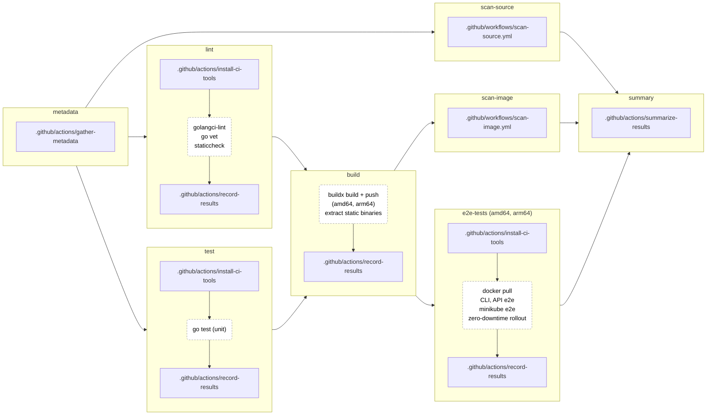
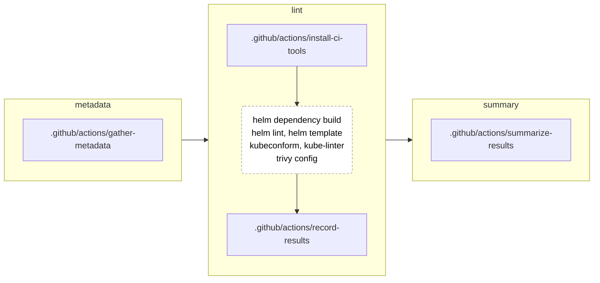
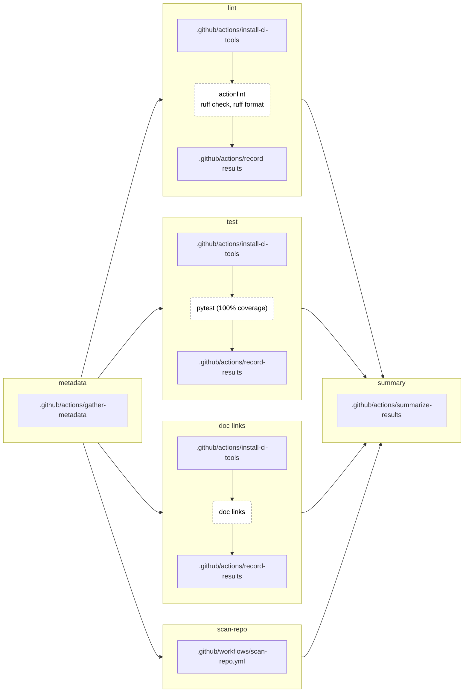
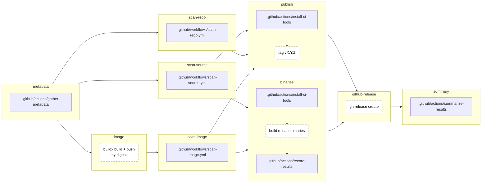
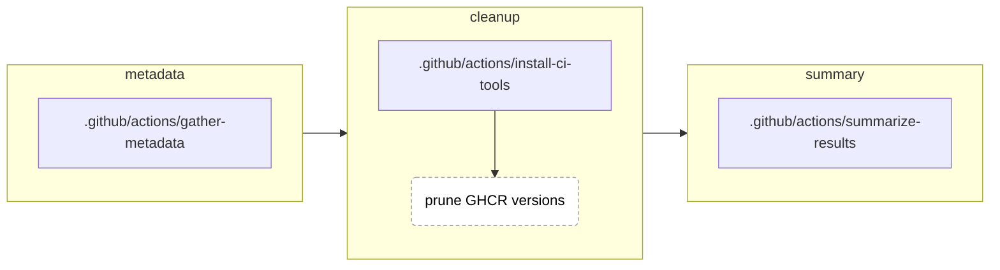
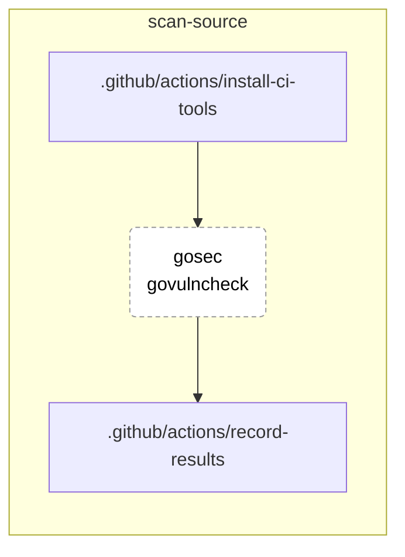
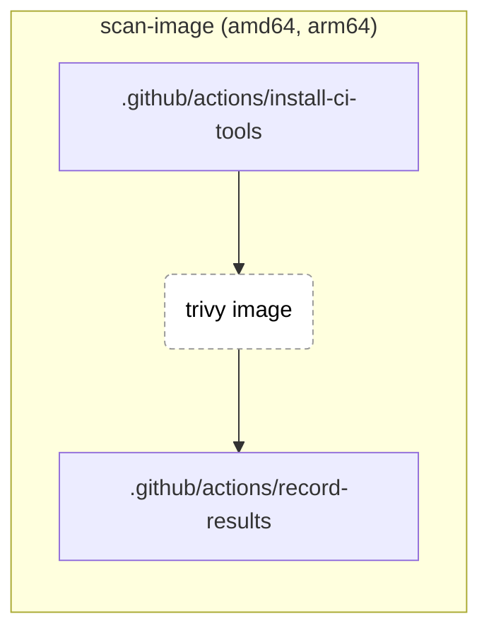
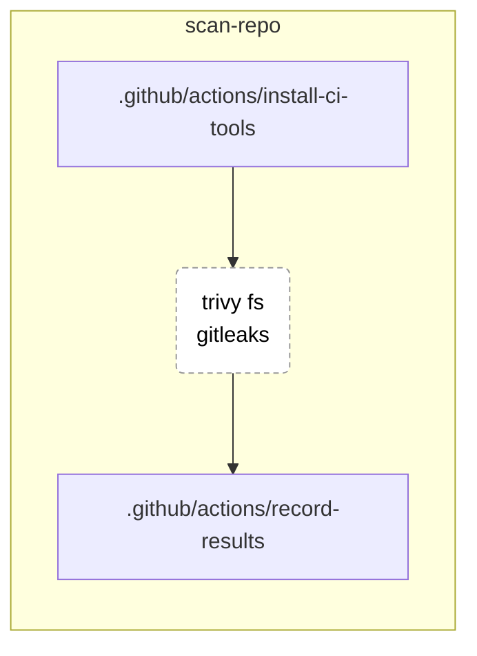

# GitHub

Map of `.github/`: what each workflow and composite action does, and who calls what. Behaviour and rationale live in [CI.md](CI.md).

## Contents

- [Call graph](#call-graph)
  - [app-ci.yml](#app-ciyml)
  - [helm-ci.yml](#helm-ciyml)
  - [common-ci.yml](#common-ciyml)
  - [release.yml](#releaseyml)
  - [cleanup.yml](#cleanupyml)
  - [scan-source.yml](#scan-sourceyml)
  - [scan-image.yml](#scan-imageyml)
  - [scan-repo.yml](#scan-repoyml)
- [Workflows](#workflows)
- [Actions](#actions)
- [Scripts](#scripts)

## Call graph

One diagram per workflow. Boxes are jobs, linked by `needs:` (edges implied by another path are left out). Inside a job, steps run top to bottom: square blocks are the local actions and reusable workflows it `uses:`, dashed blocks are the work its own steps do.

### app-ci.yml

[`.github/workflows/app-ci.yml`](../.github/workflows/app-ci.yml)

### helm-ci.yml

[`.github/workflows/helm-ci.yml`](../.github/workflows/helm-ci.yml)

### common-ci.yml

[`.github/workflows/common-ci.yml`](../.github/workflows/common-ci.yml)

### release.yml

[`.github/workflows/release.yml`](../.github/workflows/release.yml)

### cleanup.yml

[`.github/workflows/cleanup.yml`](../.github/workflows/cleanup.yml)

### scan-source.yml

[`.github/workflows/scan-source.yml`](../.github/workflows/scan-source.yml)

### scan-image.yml

[`.github/workflows/scan-image.yml`](../.github/workflows/scan-image.yml)

### scan-repo.yml

[`.github/workflows/scan-repo.yml`](../.github/workflows/scan-repo.yml)

## Workflows

| Workflow | Trigger | Jobs | Calls |
|---|---|---|---|
| [`app-ci.yml`](../.github/workflows/app-ci.yml) | PR/push to `main` on `src/**`, `helm/**`, `scripts/**`, `.github/scripts/**`, itself, `scan-*.yml`, `.github/actions/**`; manual | `metadata`, `lint`, `test`, `build`, `scan-source`, `scan-image`, `e2e-tests` (amd64, arm64), `summary` | `scan-source.yml`, `scan-image.yml`; all four actions; `extract-binary.sh`, `minikube-e2e.sh`, `rollout-check.sh` |
| [`helm-ci.yml`](../.github/workflows/helm-ci.yml) | PR/push to `main` on `helm/**`, itself, `.github/actions/**`; manual | `metadata`, `lint`, `summary` | all four actions |
| [`common-ci.yml`](../.github/workflows/common-ci.yml) | every PR/push to `main` (no path filter); manual | `metadata`, `lint`, `test`, `doc-links`, `scan-repo`, `summary` | `scan-repo.yml`; all four actions; `check_doc_links.py` |
| [`release.yml`](../.github/workflows/release.yml) | push of tag `vX.Y.Z` | `metadata`, `image`, `scan-source`, `scan-repo`, `scan-image`, `publish`, `binaries`, `github-release`, `summary` | all three scans; all four actions; `release-binaries.sh` |
| [`cleanup.yml`](../.github/workflows/cleanup.yml) | weekly (Mon 03:17 UTC); manual with `dry-run`, `max-age-days` | `metadata`, `cleanup`, `summary` | `gather-metadata`, `install-ci-tools`, `summarize-results`; `ghcr_cleanup.py` |
| [`scan-source.yml`](../.github/workflows/scan-source.yml) | `workflow_call` | `scan-source` (gosec, govulncheck) | `install-ci-tools` (`app`), `record-results` |
| [`scan-image.yml`](../.github/workflows/scan-image.yml) | `workflow_call`, inputs `image`, `registry` | `scan-image` (amd64, arm64) | `install-ci-tools` (`scan`), `record-results`; `trivy-image.sh` |
| [`scan-repo.yml`](../.github/workflows/scan-repo.yml) | `workflow_call` | `scan-repo` (trivy fs, gitleaks) | `install-ci-tools` (`repo`), `record-results` |

`cleanup.yml` scheduled and manual runs only start once the workflow is on `main`. `app-ci.yml`'s path filter includes `scan-*.yml`, so a change to a reusable scan runs app CI.

## Actions

| Action | Does | Inputs | Used by |
|---|---|---|---|
| [`gather-metadata`](../.github/actions/gather-metadata/action.yml) | Branch, SHA, commit message, trigger reason, branch slug, image ref and registry ([CI.md#gather-metadata](CI.md#gather-metadata)) | `image` (registry override) | `metadata` job of every top-level workflow |
| [`install-ci-tools`](../.github/actions/install-ci-tools/action.yml) | Pinned, checksum-verified, cached tools per suite ([CI.md#tool-pins](CI.md#tool-pins)) | `suite` (`app`, `helm`, `minikube`, `scan`, `repo`, `release`, `github`), `k8s-version` | every job that runs a tool, and `summarize-results` |
| [`record-results`](../.github/actions/record-results/action.yml) | Uploads one `kind\|check\|outcome\|conclusion` row per check as an artifact ([CI.md#build-summary](CI.md#build-summary)) | `rows`, `scope` | every test and scan job |
| [`summarize-results`](../.github/actions/summarize-results/action.yml) | Renders the Tests and Security tables into the run summary with `render.py` | `order` | `summary` job of every top-level workflow |

## Scripts

| Script | Does | Called by |
|---|---|---|
| [`extract-binary.sh`](../.github/scripts/extract-binary.sh) | Copies one arch's binary out of the pushed image, fails unless static | `app-ci.yml` `build` |
| [`minikube-e2e.sh`](../src/test/e2e/minikube-e2e.sh) | Deploys the chart to minikube, runs `TestAPI` through the Gateway | `app-ci.yml` `e2e-tests`, locally |
| [`rollout-check.sh`](../src/test/e2e/rollout-check.sh) | Polls `/ping` through the Gateway during a rolling restart, fails on any non-200 ([CI.md#rollout-verification](CI.md#rollout-verification)) | `app-ci.yml` `e2e-tests` |
| [`trivy-image.sh`](../.github/scripts/trivy-image.sh) | trivy image scan per arch, govulncheck-filtered | `scan-image.yml` |
| [`check_doc_links.py`](../.github/scripts/check_doc_links.py) | Checks doc links and anchors ([CI.md#doc-links](CI.md#doc-links)) | `common-ci.yml` `doc-links` |
| [`ghcr_cleanup.py`](../.github/scripts/ghcr_cleanup.py) | GHCR retention policy ([CI.md#image-cleanup](CI.md#image-cleanup)) | `cleanup.yml` |
| [`render.py`](../.github/actions/summarize-results/render.py) | Renders result rows as Markdown tables | `summarize-results` |
| [`release-binaries.sh`](../.github/scripts/release-binaries.sh) | linux binaries from the scanned image, darwin cross-compiled | `release.yml` `binaries` |
| [`act.sh`](../.github/scripts/act.sh) | Runs a workflow locally with act ([LOCAL-TESTING.md#act-wrapper](LOCAL-TESTING.md#act-wrapper)) | developers |
